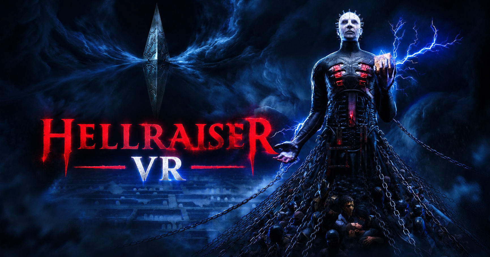

# Clive Barker's Hellraiser: Revival – UEVR VR Profile

A full motion-controller VR conversion of Clive Barker's Hellraiser: Revival for UEVR, with visible hands or IK arms, guns that shoot where you point them, physical melee, manual reloads, a Genesis cube that works from your left hand, physical throwing and a stable, comfortable camera. Special thanks to praydog, jbusfield (for his libs framework), and joeyhodge!

## IMPORTANT!

- My custom UEVR backend is required - see the releases on [letmein-vr/UEVR](https://github.com/letmein-vr/UEVR/releases) to download it.
- Inject UEVR at the main menu.

## Features

### Hands and body

- **Three hand modes.** Pick **Hands** (glove hands cut from the game's own arm mesh), **IK Arms** (full arms from your shoulders to the controllers, elbows solved in between) or **IK Arms + Body** (IK arms plus Aidan's body and legs, shoulders following the body). Switch live from the top of the Hellraiser VR panel.
- **Per-item hand poses.** The hands wrap correctly around pistols, rifles, knives, machetes, bats, bottles, rocks and the Genesis cube, with separate grip and trigger poses.
- **Stretch and reach.** In the IK modes the arms stretch slightly instead of snapping when you reach far.

### Weapons and combat

- **Weapon in hand.** The equipped weapon sits in your right hand (or on the IK hand) and aims where you point it. Bullets come out of the barrel thanks to a small native plugin (HellraiserAimFix.dll, source in `source/HellraiserAimFix`).
- **Two-handed aiming.** Bring your left hand to the gun and grab with the left grip; the gun then pivots between both hands. Pistols and the revolver also take the left hand as a support grip. The hand glides on and off the gun.
- **Dynamic reticule.** A weapon reticule at the barrel's aim point, with size, distance and brightness settings.
- **Revolver scope.** The revolver's scope upgrade is a real picture-in-picture scope; zoom with the right stick.
- **Physical melee.** With a melee weapon out, swing it into an enemy and the attack lands where the weapon touched. The game's own hit check is moved onto your weapon and aimed at the touched spot, so legs, arms and heads are hit where you strike them. Dead bodies and breakables (crates, vases, barrels) can be hit too.
- **Manual reload.** Press X (the game's reload) and the magazine drops out. Take a fresh one from the pouch on your left hip with the left grip, push it into the gun, and after an empty magazine rack the slide or charging handle with your left hand - the hand holds on to the slide while you pull. Colt 1911, AK-47 and SMG (the shotgun and revolver reload as in the game).
- **Physical throwing.** Bottles and rocks are thrown by hand: hold RT, swing and let go. They fly with the speed and direction of your swing.
- **Body holsters.** Press the right grip with your hand at a body spot to switch weapons: left hip, right hip, right shoulder, left shoulder (weapon slots 1-4), or in front of your eyes for the flashlight.

### Genesis cube

- **Cube in the left hand.** The Genesis cube sits in your left hand, also next to the Genesis weapons.
- **Telekinesis from the hand.** Grabbing, pulling and throwing objects aim with your left hand, not your head, with its own reticule and the hold countdown ring. Telekinesis puzzle objects follow the left hand too.
- **Held objects** float above the cube, where you can see them.

### Interaction

- **Interaction pointer.** A beam from your left hand picks the item, door or prompt you point at, and A interacts with it as usual. Style, colour and visibility are adjustable.
- **Grab pickups.** Reach for an item or point at it and press the left trigger to pull it into your left hand; A takes it, letting go of the trigger drops it.
- **Inspected items.** Items you pick up to inspect are held at a comfortable distance in front of you; rotate them with the right stick.
- **Puzzles.** Lockpicks, keypads and other focus puzzles switch to the game's camera and controls automatically; keypad buttons get a clearer highlight.
- **Seated and scripted scenes.** Being tied to the chair, ladders and in-world cutscenes hand control to the game where needed and give it back afterwards.

### Camera and comfort

- **Steady camera.** Camera shake, camera animations, the screen vignette and the blood splash overlay are disabled.
- **Correct body and eye height,** with an adjustable player collision capsule so you fit through tight spots.
- **Quick turn.** Hold the left stick down and click the right stick to turn 180°.
- **Head-locked UI.** The HUD follows your view in gameplay; menus and pause screens are locked in place in front of you. Distance, size and position are adjustable.
- **X / B swap** for a more natural VR button layout (on by default).

## Controls

| Action | Input |
|---|---|
| Move | Left stick |
| Turn | Right stick |
| Quick turn (180°) | Hold left stick down + click right stick |
| Fire / melee attack | Right trigger, or swing a melee weapon into an enemy |
| Two-hand a gun | Bring the left hand to the gun, hold left grip |
| Reload | X, then left grip at the left hip for a new magazine, push it in; rack the slide with the left grip after an empty magazine |
| Throw a bottle / rock | Hold right trigger, swing, release |
| Switch weapon | Right grip at left hip / right hip / right shoulder / left shoulder |
| Flashlight | Right grip in front of your eyes |
| Interact | Point the left-hand beam, A |
| Grab a pickup | Left trigger (reach or point), A to take it |
| Genesis cube | Aim with the left hand |
| Inspected item / puzzles | Right stick |
| Revolver scope zoom | Right stick up / down |

## Installation

1. Install my custom UEVR (see above).
2. Import this profile in UEVR (or copy the files into `%APPDATA%\UnrealVRMod\Hellraiser-Win64-Shipping`).
3. Start the game and inject UEVR at the main menu.

## Tuning

Everything is adjustable in the **Hellraiser VR** panel in the UEVR overlay, without editing files. The main panel has the everyday switches (hand mode, two-handing, holsters, throwing, manual reload, physical melee, pointer, UI); detailed tuning for each feature sits under **Dev Config** at the bottom:

- **Attachments** – per-weapon position, rotation and melee flag.
- **Hands / IK Arms + Body** – rig offsets, shoulders, legs.
- **Two-Handed Aiming** – grab button, radius, glide, left-hand pose.
- **Physical Melee** – swing speed, contact size, anim speed, touched-spot aim and hit width.
- **Manual Reload** – pouch position, magazine hold, insert and rack settings, per weapon.
- **Throwables, Genesis Cube, Holsters, Interaction Pointer, Inspected Items, Keypads, Player Capsule, Camera** – their own sections.

## Under the hood

Built on jbusfield's shared uevrlib Lua framework, running on my UEVR backend. Game-specific logic lives in small scripts on top of the framework (hands bootstrap, weapon handling, physical melee, manual reload, throwables, the Genesis cube, interaction, puzzles and camera handling).

The native plugin (HellraiserAimFix.dll) hooks the game's own trace calls: gun shots start at the barrel, the melee hit check is moved onto the weapon and aimed at the spot it touched, and the Genesis cube's targeting and throws aim from the left hand. Its source is in `source/HellraiserAimFix` (build paths in its CMakeLists.txt point at local folders and need adjusting).
